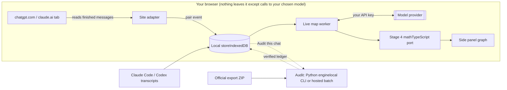

Contents

1. [What exists today](#repo)
2. [The engine, measured](#cost)
3. [Ways to connect](#connect)
4. [Recommended build](#arch)
5. [Live map and audit](#tiers)
6. [Who it is for](#useful)
7. [UX](#ux)
8. [Problems to solve](#risks)
9. [Costs per user](#money)
10. [Roadmap](#roadmap)
11. [Your decisions](#decide)
12. [Sources](#sources)

Timeline repo · product research · 8 October 2026

# Can CoTrace map your real ChatGPT and Claude chats as they happen?

Yes. The engine already works on real chats. What blocks a public release is how you reach the chats, what each message costs to process, and whether people will trust you with their conversations. This report covers all three and recommends a build order.

## Short answer

1. **Build a local-first browser extension with a side panel.** It is the only option that reads every message, in real time, from the ChatGPT or Claude account someone already pays for. An app inside ChatGPT or Claude (MCP Apps) is official, but it only sees what the model decides to pass it. That's too little for a faithful map.
2. **Split the engine into a fast live map and a slower audit.** Measured on your corpus, one message pair costs about **$0.28** and takes about **2 minutes** of serial LLM time. A live side panel needs under 10 seconds and under a cent per pair. The map can be live. The numbers (direction %, decisions) come from the audit.
3. **Treat trust as a feature.** Since December 2025, extensions with millions of users were caught selling ChatGPT and Claude chats, and Chrome tightened its data rules in July 2026. Yours has to process on the user's device, call the model with the user's own key, be open source, and ask only for chat-site permissions.
4. **Prove real-time on your own Claude Code and Codex sessions first.** Those transcripts sit on your disk as JSONL, Claude Code has an official hook that fires after every turn, and there's no terms-of-service question. It's the quickest way to watch nodes appear live before you take on site scraping.

## What exists today (verified in the repo)

I read the specs, the engine, the design pack, the BUILDLOG and the full git history. This is the state on `master` at `bb7ab0a` (tag `e2-done`), 11 commits ahead of GitHub.

| Piece | State | Where | Reusable for live? |
| --- | --- | --- | --- |
| Extraction pipeline, Steps 1a–3 | Done (E1), graded on golden chat, invariants 1–9 green on 10 chats | `engine/pipeline.py`, `prompts.py` | Yes as the audit tier |
| Stage 4 math (direction, decisions, mode, timeline, goal tree) | Done (E2), exact fixture numbers, pure arithmetic, 101 tier-1 tests | `engine/quant.py`, `projections/panel.py` | Yes, portable to TypeScript |
| Source-agnostic design | Engine consumes "pair events" and doesn't care where they come from | `docs/Architecture.md` §1 | Yes, this is the seam every connector plugs into |
| Importer | Claude web JSON and Markdown only, with fidelity grading | `scripts/ingest_export.py` | Partly, no ChatGPT format yet |
| Obsidian 2D graph and 3D view | Working prototypes over 12 chats with a pair scrubber; reads a static compiled file, not the engine | `design_pack/` (untracked) | Partly, needs a live data source |
| Graph rules | Deterministic field-to-visual mapping (mass, beads, rings, bullseyes, dormancy, focus beacon) | `design_pack/GRAPH_SYSTEM_SPEC.md` | Yes |
| Live chat server (FastAPI + SSE + streaming) | Built in Phase 3, deleted in the engine-first re-plan; still in git | commits `f4f8d69`…`27e7d68` | Yes, restore and point at real artifacts |
| Corpus | 55 entries; c37–c55 and the manifest change aren't committed yet | `data/corpus/` | Test data for live-tier grading |

**Claude Code setup:** `Claude.md` imports `@AGENTS.md`, but that file had become `Agents Documentation.md`, so Claude Code sessions in Timeline loaded no project rules. I added an `AGENTS.md` symlink to it. That one link fixes both Claude Code and Codex. It's uncommitted, and nothing else in the repo was touched.

## The engine, measured

Numbers below come from each chat's `run/llm_monitor.txt` (every call, with tokens and elapsed time). Cost uses Gemini 3.5 Flash at $1.50 / $9.00 per million tokens in/out and 3.1 Flash-Lite at $0.25 / $1.50, from third-party price trackers. Thinking tokens are billed as output and are included.

| Chat | Pairs | LLM calls | Tokens | Cost | Per pair | LLM seconds / pair |
| --- | --- | --- | --- | --- | --- | --- |
| c03 coding | 3 | 37 | 180,368 | $1.05 | $0.35 | 134 |
| c04 writing | 4 | 44 | 203,877 | $1.18 | $0.30 | 116 |
| c05 research | 7 | 59 | 404,677 | $2.27 | $0.32 | 118 |
| c07 research | 4 | 23 | 108,247 | $0.59 | $0.15 | 58 |
| c10 / c16 / c17 research | 1 each | 29 | 89,521 | $0.46 | $0.10–0.21 | 46–85 |
| c20 coding | 3 | 44 | 206,421 | $1.17 | $0.39 | 755\* |
| c27 / c30 creative | 2 each | 47 | 207,008 | $1.19 | $0.30 | 116 |
| All 10 chats | 28 | 283 | 1,400,124 | $7.91 | $0.28 | \~120 |

\* c20 includes slow or retried calls. Seconds are summed call time; some Step 2 and Step 3 calls could run in parallel, so wall time can be lower.

### Where the money goes

| Step | Job | Calls | Avg cost | Avg seconds | Thinking share of output |
| --- | --- | --- | --- | --- | --- |
| 1a | Actions (Flash-Lite) | 28 | $0.002 | 3.2 | 0% |
| 1b | Outcome tree | 28 | $0.037 | 13.0 | 76% |
| 1c | Intentions | 28 | $0.011 | 5.3 | 84% |
| 2 | Requirements and open questions, per touched outcome | 66 | $0.023 | 18.6 | 82% |
| 3a | Influence, new requirement | 104 | $0.040 | 25.9 | 55% |
| 3b | Influence, incremental | 29 | $0.028 | 11.2 | 70% |

Three things follow from this:

- **Step 3 is about 60% of the bill**, as the pipeline spec predicted in §12.7. It's also what produces the ledger mass behind node size and the direction split.
- **Hidden reasoning is most of the output.** Lowering the thinking budget on Steps 1b, 1c and 2 is the cheapest experiment you can run, but it has to be re-graded against the golden chat before you trust it.
- **The graph structure itself is cheap.** Outcomes, requirements, open questions and who created them come from Steps 1a, 1b and 2. Steps 1c and 3 aren't needed to draw the nodes.

## Ways to connect to someone's chats

Neither OpenAI nor Anthropic offers a public API that lets a third party read a consumer account's chat history. These are the real options.

| Route | Real-time | Sees the whole chat | Terms risk | Who it reaches | Verdict |
| --- | --- | --- | --- | --- | --- |
| **Browser extension** reading the chat page | Yes 1–2 s after a reply ends | Everything rendered: current branch, text, code. Not hidden tool data or other branches | Gray OpenAI's terms bar "programmatic extraction". Read-only, user-initiated, on-device is the lowest-risk form | Desktop Chrome, Edge, Brave, Firefox. Not the mobile apps | Main product |
| **Official data export** (ZIP from settings) | No manual, can take hours | Yes. ChatGPT's includes branches | None | Everyone | History backfill |
| **Agent transcripts** (Claude Code, Codex JSONL on disk) | Yes Claude Code Stop hook passes the transcript path | Yes, including tool calls | None files you own. Format is internal and can change | Developers | First test bed and a strong niche |
| **MCP App** inside ChatGPT or Claude | Only when called | No only what the model passes to the tool. No conversation ID is passed | None official standard since Jan 2026 | Claude and ChatGPT web and desktop | Later as a "show my map" companion |
| **Your own chat app** with an API key (the old Phase 3 server) | Yes | Yes | None | Only people willing to leave ChatGPT or Claude | Research mode |
| **Private web endpoints** (ChatGPT's internal `backend-api`) | Yes | Yes, with branches | High undocumented, breaks often, clearly programmatic extraction | — | Don't |

An MCP App has a deeper problem than missing data. The AI would summarize its own influence for the map, and that contradicts the project's rule that the panel is "a mirror, not a judge" with every number traced to a verbatim quote.

### Similar products, and what they show

- **Chat-to-graph extensions** (ChatMind Visualizer, MindTree, ChatTree, ChatGPT Graph View, AI Chat Navigator) draw the message tree or a topic mind map. All are small: hundreds to about a thousand users, low ratings, and listings that mention breakage after site changes. None extracts goals, requirements, open questions or who decided what. That gap is yours.
- **Organizer extensions** (Superpower ChatGPT, about 100k users) show demand for working on top of ChatGPT, along with the recurring pain: features vanish after ChatGPT updates, and users worry about privacy.
- **Export-to-Obsidian tools** (Nexus AI Chat Importer, Claude Vault, MemoryPlugin) work from official exports. Claude Vault tags chats with a local Ollama model, and MemoryPlugin sells continuous sync. Your users already put chats into Obsidian, so a Markdown and canvas export is a cheap win.

## Recommended build

### Extension stack

Framework

WXT (Manifest V3, Vite-based)

UI

React + TypeScript + Zustand

Surface

chrome.sidePanel / Firefox sidebar

Storage

IndexedDB (Dexie)

Graph

Port the Obsidian canvas view

LLM

Direct calls, JSON-schema outputs

It reuses your web stack. Structured outputs replace `json_repair`.

### What stays in Python

- The full pipeline, as the audit tier and the reference implementation
- Importers, including a new ChatGPT `conversations.json` parser
- Corpus grading: live map vs audit agreement
- Stage 4 parity test: the TypeScript port must reproduce 21.7% / 78.3%, 4 / 10 and COPILOT on the frozen fixture exactly

### One live turn inside the extension

1. You send a message on chatgpt.com. The adapter notes it and waits.0 s
2. The reply finishes streaming. The adapter waits for the stop button to disappear plus a short debounce, then reads both turns as rendered text and stores a pair event with a content hash.+1.5 s
3. The side panel shows the new pair on the scrubber with a "mapping" state. The previous map stays on screen, as in INTERACTION_SPEC §4.+1.5 s
4. The live worker sends the new pair plus a compact state summary to the model with the user's key.+3–8 s
5. Stage 4 recomputes in TypeScript. Nodes are born or reactivate, open questions appear as rings, resolved ones become bullseyes, and the focus beacon moves.+\<50 ms
6. If an earlier message was edited or regenerated, its hash changes. The map marks everything from that pair on as stale and replays from the last good snapshot.on change

## Live map and audit: two tiers, one visual language

|  | Live map | Audit |
| --- | --- | --- |
| Shows | Outcome nodes, requirement beads with creator color, open-question rings, bullseyes, dormancy, focus beacon | Everything, plus ledger mass, direction %, decision counts, mode, evidence quotes |
| Runs | Every pair, automatically, for chats past 2 pairs | When you click "Audit this chat", at session end, or in a nightly batch |
| Option A: existing steps 1a + 1b + 2, thinking reduced | No new prompts. About $0.03–0.09 and 15–35 s per pair (from the step table) | Full Steps 1a–3 plus Stage 4. $0.28 per pair today; the target is under $0.10 through thinking budgets, Step-3 candidate filtering (spec §9.5) and batch pricing |
| Option B: one new live prompt | About $0.004 and 3–8 s per pair on Flash-Lite (estimate). Needs a new spec written at the command center and graded on the corpus |  |
| Node size | Provisional: count of bound actions, drawn with a dashed shell | Ledger mass, solid shell |

provisional (live map) verified (audited)

This split keeps the repo's core rule intact: the map can appear quickly, but a percentage only appears once it traces to a quote. My recommendation is Option B for the product, with Option A as the fallback that needs no new prompts.

## Who would actually use it

Most chats are short questions, and a graph of a two-message chat is noise. The map earns its place in long, multi-session work. Put plainly, people will open it for **three lists**, and the graph is how they move between them.

### Loose ends

Questions the AI asked that you never answered (hollow rings), and open questions that were quietly dropped. Nothing else on the market shows this.

### Decisions, and who made them

Every requirement with its creator, and the bullseyes the AI resolved on its own. Reviewing the orange ones is like reviewing a pull request.

### Where we are

The active branch, dormant branches, and what changed since you last opened the chat. This replaces scrolling back through 40 messages.

| Use case | Why it fits | Strength |
| --- | --- | --- |
| Long research, planning and writing chats | Many outcomes, open questions, multi-day sessions | Strong |
| Agentic coding (Claude Code, Codex) | The agent makes many decisions unasked. Orange bullseyes are the review list | Strong |
| Continue in a new chat | Export the decision record as a prompt when you hit a usage limit or the context fills up | Strong, people already install extensions for this |
| Students reflecting on their own agency | "Did I think, or did the AI?" The direction split is the hook | Medium sensitive if a teacher can see it |
| Obsidian users | Export the map as Markdown notes and a canvas | Medium cheap to add |
| Managers monitoring a team's AI use | Possible through enterprise compliance APIs | Avoid turns the mirror into surveillance |

## UX that will hold up

- **The side panel follows the tab.** Open a chat and its map is there. Switch chats and the panel switches. Below 3 pairs it shows a one-line state ("Map starts after a few exchanges") and spends nothing.
- **Catch-up on open.** When you open an old chat, or one you continued on your phone, the adapter reads the visible history and maps the missing pairs, oldest first, with progress on the scrubber.
- **Nothing processes until the user says so per site.** The first run asks "Map chats on chatgpt.com?" and shows exactly where data goes: "To Google Gemini using your key. Nowhere else."
- **Click a node to jump to the message** (already in GRAPH_SYSTEM_SPEC Step 4.5). It's the feature that makes the graph worth having.
- **Lists before the graph on narrow panels.** A side panel is about 360–420 px wide, so the graph needs a list mode and a pop-out full-tab view for big maps.
- **Pause, forget this chat, delete everything.** All three should be visible and one click away.

| Surface | Good | Bad |
| --- | --- | --- |
| Side panel (recommended) | Never covers the chat, survives site redesigns, an official Chrome API | Narrow; graph needs a list fallback |
| Overlay injected into the page | Feels built in | Breaks on every redesign, collides with site UI, highest terms risk |
| Full tab "universe" | Room for the cross-chat graph and the later "head" view | Not beside the conversation |
| MCP App widget in the chat | Official, works where users already are | Only on request, model-curated data, costs the user's message quota |

## Problems that will come up, and fixes

| Problem | Why it happens | Mitigation |
| --- | --- | --- |
| Trust | Malicious extensions with millions of users harvested and sold AI chats (Dec 2025 to Jun 2026) | Local-first, bring your own key, open source, no analytics, only chat-site host permissions, a plain privacy page |
| Chrome Web Store policy | The July 2026 update requires collection to be strictly necessary and prominently disclosed, and bans tools that get around AI services' safeguards | Single stated purpose, in-product disclosure before the first run, no circumvention of limits, no automation of sending |
| OpenAI and Anthropic terms | Bans on programmatic extraction of data or output | Read only what the user sees, only when they look, only for them. Never call private endpoints. Get a legal review before a public launch |
| Site changes break capture | ChatGPT and Claude redesign often | One adapter file per site, role attributes over CSS classes, a DOM-snapshot test suite, a visible "capture paused, site changed" state |
| Edits and regenerations | Both sites fork a chat when you edit a message; the engine assumes one line of pairs | Hash each pair, keep per-pair state snapshots (like `checkpoint_pN.json` in the design pack), replay from the changed pair |
| Chats that wander across topics | Real chats drift; the outcome tree has one root (SPEC_QUESTIONS Q7, open) | Decide Q7 before live: allow a forest of roots, or tangent nodes that float free as the graph spec already describes |
| Long chats get slow and expensive | Steps 1b and 2 resend everything (spec §12.2) | Rolling state summary for the live tier, provider prompt caching, audit runs only on demand |
| Sensitive content | Health, legal, work secrets, pasted API keys | Secret scanner that redacts before any call; per-chat "don't map"; the user's own provider choice |
| GDPR, if you host anything | You become a processor of possibly special-category data | Stay local-first in v1. A hosted tier needs a DPA, EU hosting, deletion and export |
| Images, files, canvases, tool output | The page shows partial text | Reuse the importer's fidelity grade and show it on the map |
| Wrong extractions | LLM error | Runtime invariants in the extension, a provisional style, and "this is wrong" feedback that saves the pair for the corpus (with consent) |
| Mobile | The ChatGPT and Claude apps can't be extended | Catch-up when the chat is opened on desktop; a periodic export import |

## Costs per user

These are estimates from the measured per-pair numbers above, assuming 10% of pairs get audited.

| Monthly use | Live, option B | Live, option A | Audit today | Audit at target |
| --- | --- | --- | --- | --- |
| Light, 100 pairs | $0.40 | $3–9 | $2.80 | $0.80 |
| Regular, 400 pairs | $1.60 | $12–36 | $11.20 | $3.20 |
| Heavy, 1,200 pairs | $4.80 | $36–108 | $33.60 | $9.60 |

With the user's own key, a free extension works at any of these levels, and the user sees their spend. A hosted plan around $6–8 a month only works with Option B and an audit under $0.10 per pair. Backfilling a whole history (say 300 chats × 8 pairs) costs about $10 on the live tier and about $670 on today's audit, so history mapping must use the live tier.

## Roadmap: nodes first, the "head" later

| Phase | Build | Done when |
| --- | --- | --- |
| N0 | Nodes on real engine output: the Obsidian view reads `state.json` and `ledger.jsonl` through the restored FastAPI and SSE server. Commit `design_pack/`. Decide Q7. | All 10 corpus chats render from engine artifacts, and the scrubber matches the GRAPH_SYSTEM_SPEC audit tables pair by pair. |
| N1 | Live-map spec and measurement: thinking-budget trial, Option B prompt, a grader comparing live map against audit on the corpus. | Agreement threshold met on outcomes, requirements and open questions, under 10 s and under $0.01 per pair. |
| N2 | Live on your own sessions: a Claude Code Stop hook and a Codex file watcher emit pair events, and the map updates in a local browser tab. | You use it for a week on real work. |
| N3 | Extension alpha: WXT side panel for claude.ai and chatgpt.com, IndexedDB, bring your own key, Stage 4 TypeScript port with fixture parity, ChatGPT export importer. | 5 testers for 2 weeks; network log shows calls only to their chosen provider. |
| N4 | Public beta: open source, privacy policy, store disclosures, legal review, Gemini adapter, Obsidian export. | Listed on the Chrome Web Store and Firefox Add-ons. |
| N5 | The head: cross-chat 3D universe, MCP App companion, optional encrypted sync. | Planned once N3 data shows people come back to the map. |

## Decisions only you can make

1. **Who pays for model calls?** Own key only (simplest, most private) or a hosted plan as well. I recommend own key for v1.
2. **Live map: Option A or B?** A keeps the spec untouched; B needs a new spec and is the only one that scales. I recommend B, with A as the fallback.
3. **Q7: one root or many?** Real ChatGPT chats need many.
4. **Open source the extension?** I recommend yes. It's the strongest answer to the trust problem.
5. **Which site first?** I recommend claude.ai, since your corpus and importer are Claude-shaped, then chatgpt.com.

## Sources

- [MCP Apps, SEP-1865](https://modelcontextprotocol.io/seps/1865-mcp-apps-interactive-user-interfaces-for-mcp) and [Claude and ChatGPT support](https://alpic.ai/blog/mcp-apps-goes-official-claude-chatgpt-support)
- [OpenAI Apps SDK reference](https://developers.openai.com/apps-sdk/reference); [no conversation ID passed to tools](https://github.com/openai/openai-apps-sdk-examples/issues/138)
- [OpenAI Terms of Use](https://openai.com/en-GB/policies/row-terms-of-use/); [automated-extraction clause](https://conductatlas.com/platform/openai/terms-of-use-row/provision/CA-P-017130/prohibition-on-automated-data-or-output-extraction/)
- [Chrome Web Store policy updates, July 2026](https://developer.chrome.com/blog/cws-policy-updates-2026)
- [Urban VPN harvesting AI chats](https://www.malwarebytes.com/blog/news/2025/12/chrome-extension-slurps-up-ai-chats-after-users-installed-it-for-privacy), [900k users hit](https://thehackernews.com/2026/01/two-chrome-extensions-caught-stealing.html), [Microsoft, March 2026](https://www.microsoft.com/en-us/security/blog/2026/03/05/malicious-ai-assistant-extensions-harvest-llm-chat-histories/), [G DATA, June 2026](https://blog.gdatasoftware.com/2026/06/38428-browser-addons-spy-on-ai-chats)
- [ChatMind Visualizer](https://chromewebstore.google.com/detail/ikgckfehbaiphhbjoomnppcfdigamgca), [MindTree](https://www.chromeboard.com/extension/mindtree-mindmap-for-chat-dgmpijkaolmbcemdkogjbmjobcjamjje), [ChatTree](https://chromeboard.com/extension/chattree-ichiiknkackionkhdadajbffjmfhkhmn), [organizer comparison](https://www.ai-toolbox.co/chatgpt-toolbox-competitors/chatgpt-toolbox-vs-superpower-chatgpt-vs-easy-folders-vs-foldermate)
- [Nexus AI Chat Importer](https://github.com/Superkikim/nexus-ai-chat-importer), [Claude Vault](https://forum.obsidian.md/t/claude-vault-turn-your-claude-chats-into-a-knowledge-base-for-obsidian-free/109275), [MemoryPlugin](https://www.memoryplugin.com/tools/chatgpt-to-obsidian)
- [Claude Code hooks](https://docs.claude.com/en/docs/claude-code/hooks); [Codex rollout files](https://codex.danielvaughan.com/2026/04/29/codex-cli-rollout-files-session-recording-replay-audit-trails/)
- [Chrome built-in AI](https://developer.chrome.com/docs/ai/built-in) (on-device Gemini Nano; a possible later option for the live tier)
- [Gemini 3.5 Flash pricing](https://pricepertoken.com/pricing-page/model/google-gemini-3.5-flash), [Flash-Lite pricing](https://anotherwrapper.com/llm-pricing/gemini-3.5-flash-lite) (third-party; check Google's rate sheet)

Repo figures come from `data/chats/*/run/llm_monitor.txt` and `report.json` at commit `bb7ab0a`. Dollar figures for Option B and audit targets are estimates, not measurements.