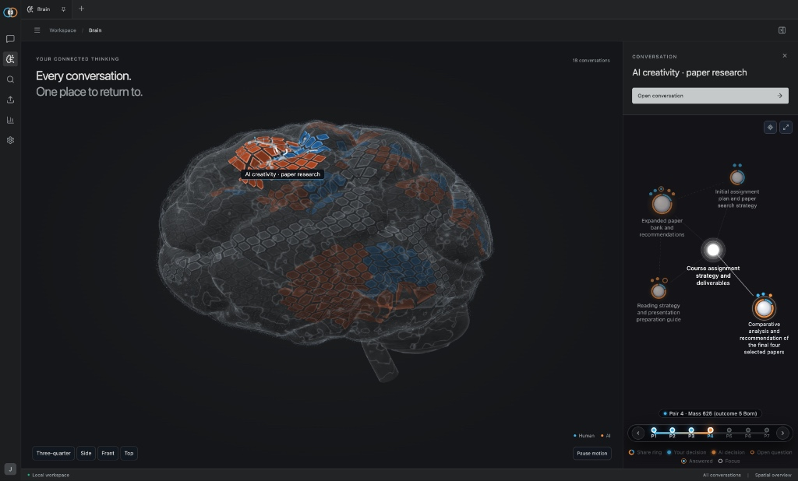
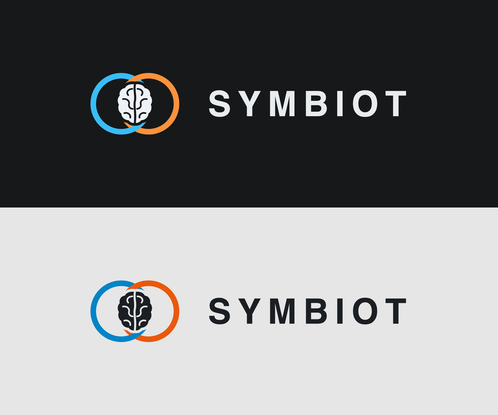
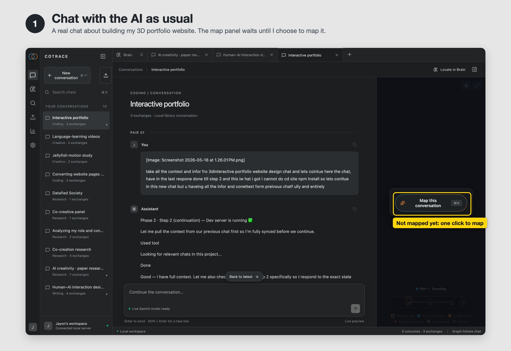
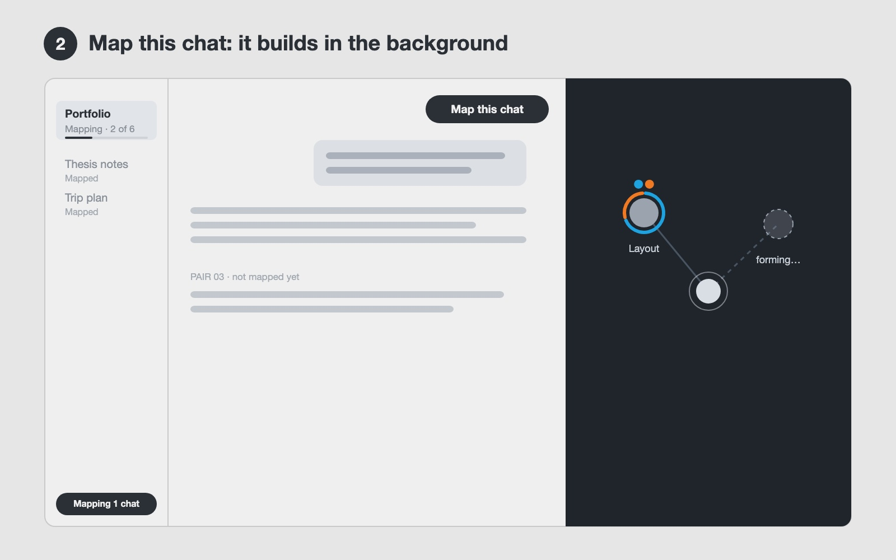
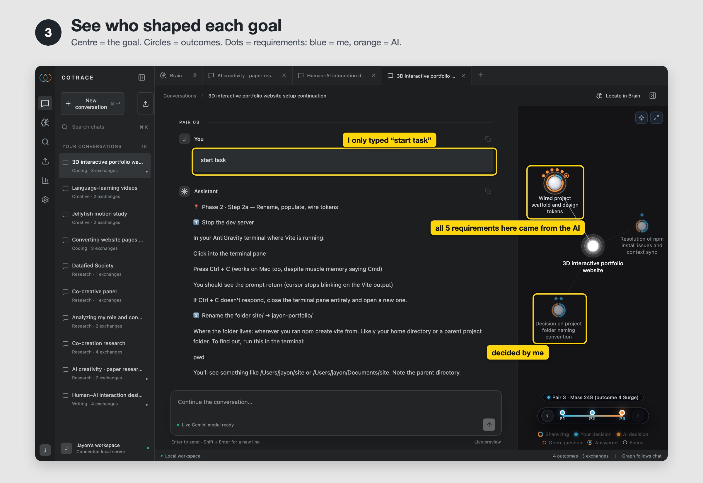
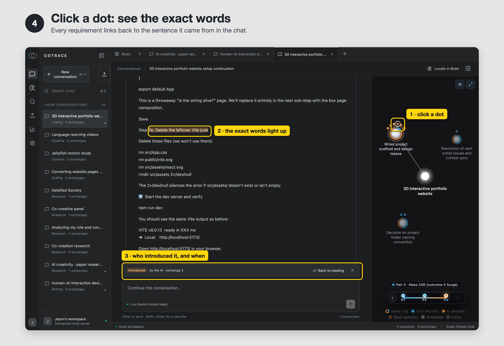
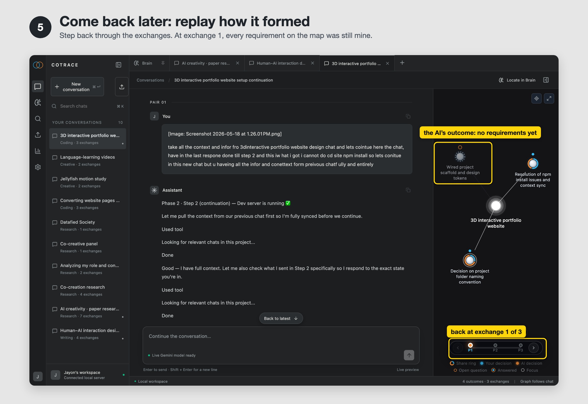
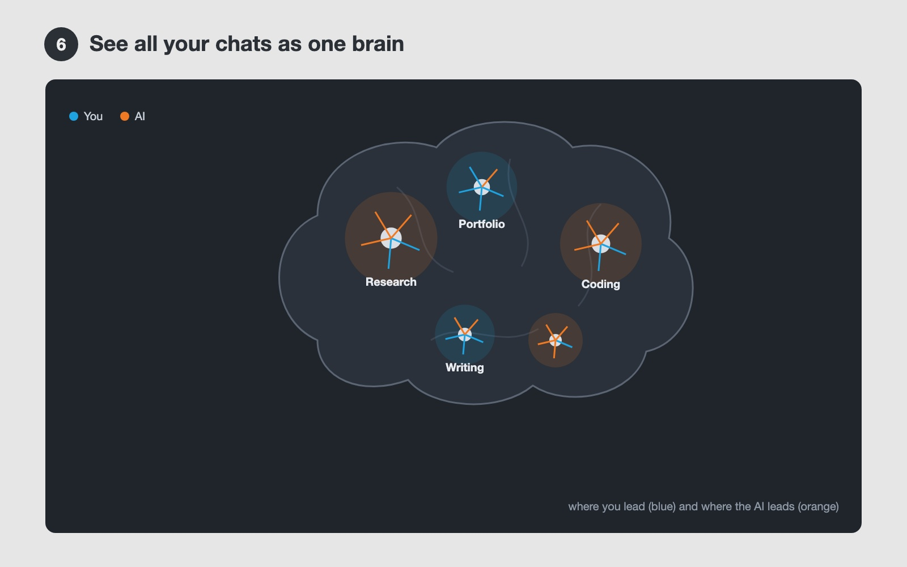

**Title:** Symbiot
**Category:** Semester project
**Student:** Jayon K Vinod
**Course Title:** Designing for Competence
**Lecturer:** _[name]_
**Year:** 2026

---

## Abstract

Symbiot is an AI chat that draws a live map of each conversation and shows which ideas came from you and which came from the AI. It sorts the dialogue into one goal, its outcomes and their requirements, colours every requirement blue (you) or orange (AI), and links it back to the exact words in the chat. A brain view shows this balance across all your chats, so you can see when the AI starts steering.

---

## In short

Symbiot is a chat interface for people who work on long creative or research projects with AI. It maps every chat into *goal → outcomes → requirements* and shows who shaped each part, so you stay aware of your own direction instead of drifting with the AI's suggestions. It is built on CoTrace, a published method for measuring how much an AI shapes a person's goals.

## Name and mark

The mark is two interlocked rings with one brain between them. The blue ring is me, the human, and the orange ring is the AI. It uses the same two colours as everything inside the app.

## Context

While building my portfolio projects with AI, I kept following suggestions that sounded good. After a few days I could no longer say which ideas were mine and which were the AI's. The chats were long and hard to look back through, and the overload made me lose track of what I had decided.

The course asks how a tool can build competence instead of replacing it. Symbiot's answer is **awareness, not restriction**: it never blocks or corrects the AI. It makes the AI's influence visible, so the human stays the one who decides.

## Platform

A desktop web app that runs locally on your computer and opens in the browser. You chat with the AI inside it, or bring in earlier chats. The chat sits on the left and its map on the right. The mapping uses a language model (Gemini) in the background.

## How the map works

The examples are from my real chat about setting up my 3D portfolio website.

| Part | What it is | Example from my chat |
|---|---|---|
| **Goal** (bright centre) | What the whole chat is about | "3D interactive portfolio website" |
| **Outcome** (circle) | Something I want to end up with | "Wired project scaffold and design tokens" |
| **Requirement** (small dot) | One concrete decision about that outcome | "Leftover Vite files must be deleted" |
| **Colour** | Who brought the requirement in | blue = me · orange = the AI |
| **Open question** (hollow ring) | Something raised but not yet decided | "Which folder name?" |
| **Share ring** | The ring around an outcome: how much of it came from me and how much from the AI | mostly orange on the scaffold outcome |
| **Timeline** (P1, P2, P3 …) | One step per exchange (my message plus the AI's reply) | 3 exchanges |

## What happens in the chat

1. I chat with the AI as usual. The map panel stays empty.
2. I press **Map this conversation** (or ⌘M).
3. In the background, the CoTrace pipeline reads the chat one exchange at a time. It finds the goal, splits it into outcomes, pulls out the requirements and decides who introduced each one: me or the AI.
4. The map grows next to the chat. The sidebar shows the progress, and I can keep reading and writing.
5. Clicking any dot scrolls the chat to the exact words it came from and highlights them.
6. The timeline replays how the map formed, exchange by exchange.
7. The Brain page shows all mapped chats together. **Locate in Brain** finds the current chat there.

**Prototype status:** everything shown below works in the current prototype. It runs locally, and mapping a chat calls the paid Gemini API.

---

## Use case: setting up my 3D portfolio website with AI

A real chat with three exchanges:

1. I ask the AI to continue the setup from an earlier chat.
2. I choose a folder name.
3. I type only "start task", and the AI answers with a long step-by-step plan.

**1. Chat with the AI as usual**

- A normal chat. The map panel waits until I choose to map it.

**2. Map it: it builds in the background**

- I press **Map this conversation**.
- The chat is analysed one exchange at a time, and the sidebar shows "Mapping · 1 of 3".
- I can keep reading and writing. Nothing is blocked.

**3. See who shaped each goal**

- The goal sits in the centre with four outcomes around it.
- Two outcomes hold only my own requirements (blue): fixing the npm install and the folder name.
- "Wired project scaffold and design tokens" holds five requirements, and all five came from the AI. Three of them arrived right after I typed only "start task".

**4. Click a dot to see the exact words**

- I click an orange dot.
- The chat jumps to the AI's sentence *"7e: Delete the leftover Vite junk"* and highlights it.
- A strip reads "Introduced by the AI · exchange 3". **Back to reading** returns me to where I was.
- Now I can decide on purpose whether I agree.

**5. Come back later and replay how it formed**

- I step back to exchange 1.
- At that point every requirement on the map was mine, and the AI's outcome had none yet.
- This shows when the AI took over.

**6. See all my chats as one brain**

- Each mapped chat claims a patch of the brain, sized by how much happened in it and grouped by topic.
- Inside each patch, blue cells are my share and orange cells are the AI's.
- Any chat is one click away.

---

## Built on

**CoTrace:** Kim, Mindel, Kim and Wu, *Measuring AI Contributions to Goal Shaping*, arXiv 2605.21363. Code: github.com/rladmstn1714/CoTrace.

CoTrace is a research method that analyses a finished chat afterwards. Symbiot adds three things on top of it:

- a map next to the chat
- a link from every requirement back to its exact words
- a brain across all chats

## How the images were made, and use of generative AI

- **All images are screenshots of the working prototype**, using one of my real chats. The step number, the title, the one-line explanation and the yellow boxes and labels were added on top afterwards. No image-generation model was used.
- To keep my private chats out of the pictures, the app ran on a copy of my library that holds only my ten reference chats.
- **Step 2** was captured in the app's rehearsal mode. It replays this chat's earlier recorded mapping through the real interface, so the in-progress state could be shown without paying for a new model run. All other steps show the normal mapped chat.
- **Claude Code (Anthropic)** helped me in two ways:
  - It drafted the text from my voice-recorded description, and I edited it.
  - It scripted the screenshots and the framing.
- **The prototype's mapping** uses a language model (Gemini) to run the CoTrace analysis.
- **The name and mark:** Claude Code proposed the logo as SVG code, in four rounds of rendered options (in `logo/`), from my brief. No image-generation model was used.

**My requests to Claude Code** (voice-transcribed, filler words removed):

> Help me write a documentation for this full project, based on the simple project description, then context. Write a very simple … what is the current workflow happening in the chat. Very simple: basically what the node does and the simple workflow of the chat. And then also write a very simple, not too complicated documentation for this.

> Please use my exact UI from the working prototype to make this. You created a new UI representation for the use case; instead, showcase it with one of my simple real chats, the side view and the exact UI, and also the Brain page.

> Change the logo and name of the app from CoTrace to Symbiot, and make the logo a mix of the rings and a brain in between, like a really good logo.

The first request also included the course brief, the DM website rules and my project description. The first version used drawn schematics. The second request replaced them with these screenshots. The third request renamed the app and added the mark, and all screenshots were retaken.

---

## Try running Symbiot with your real chats

If you want to run Symbiot locally on your machine with your own data and API key:

1. **Start the app:**
   - In your terminal, run `./cotrace start`.
   - It will open your browser at `http://localhost:8765`.
   - Ten reference chats are already loaded so you can explore the interface right away without setting anything up.

2. **Add your Gemini key (for live mapping):**
   - Click the gear icon (**Settings**) in the bottom-left corner.
   - Paste your free Google Gemini API key from [aistudio.google.com](https://aistudio.google.com).
   - Click **Test Connection** to make sure it works, then **Save**.
   - Your key stays on your computer in `~/.Cotrace/secrets.json` and is never sent anywhere else.

3. **Drop in your own chat:**
   - Click the **Upload** icon at the top of the sidebar.
   - Drag and drop your Claude or ChatGPT export file (`.zip` or `conversations.json`), or any JSON transcript.
   - Symbiot shows you the chats inside. Pick one and click **Import & Map**.

4. **Watch it map in real time:**
   - The map grows exchange by exchange next to your conversation.
   - Click any requirement node to jump straight to the exact words where you or the AI introduced it.

---

## Limitations

- **Cost:** Running the mapping calls Google Gemini in the background. Because it makes multiple model calls per exchange, it costs real money: about $0.02 for a short 3-exchange chat, and around $0.30 for a long 21-exchange chat.
- **Time:** As the dialogue grows, the pipeline takes longer because it re-checks earlier decisions to keep the map consistent. A 3-exchange chat maps in about 1 minute, but a 21-exchange chat can take 8 to 10 minutes.
- **The Brain view is early:** The Brain page is still a rough prototype. The grouping and visual layout need to be redesigned to show large libraries of chats clearly.

## Future upgrades

- **Live inside your chats:** The main goal is for people to use Symbiot directly while chatting with ChatGPT or Claude, instead of mapping it afterwards.
- **Browser extension:** Turn this standalone app into a browser extension that works on top of any AI chat interface.
- **A better Brain view:** Improve how the Brain page categorises chats by topic and visualises the balance across all of them.
- **UI polish:** Refine the interface, smooth out the transitions, and make timeline scrubbing feel better.
