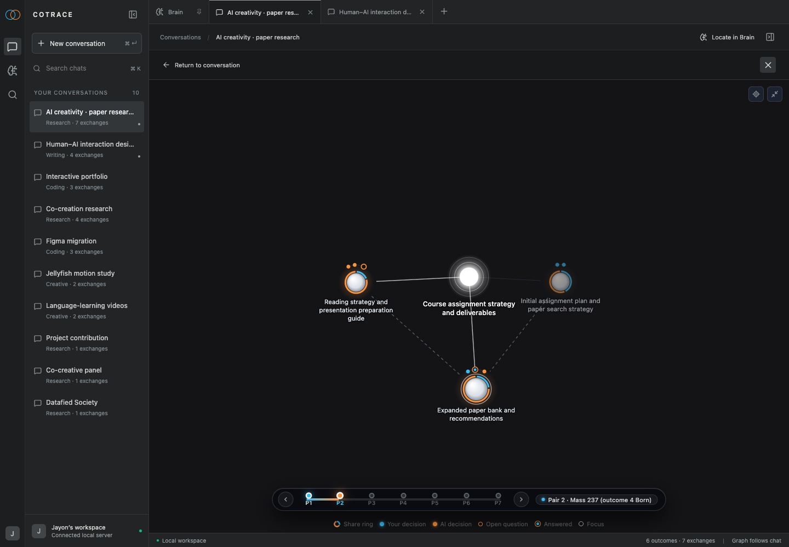

**Title:** Symbiot
**Category:** Semester project
**Student:** Jayon K Vinod
**Course Title:** Designing for Competence
**Lecturer:** _[name]_
**Year:** 2026

---

## Abstract

Symbiot is an AI chat that draws a live map of each conversation and shows which ideas came from you and which came from the AI. It sorts the dialogue into one goal, its outcomes and their requirements, colours every requirement blue (you) or orange (AI), and links it back to the exact words in the chat. A brain view shows this balance across all your chats, so you can see when the AI starts steering.

---

## In short

Symbiot is a chat interface for people who work on long creative or research projects with AI. It maps every chat into *goal → outcomes → requirements* and shows who shaped each part, so you stay aware of your own direction instead of drifting with the AI's suggestions. It is built on CoTrace, a published method for measuring how much an AI shapes a person's goals.

## Context

While building my portfolio projects with AI, I kept following suggestions that sounded good. After a few days I could no longer say which ideas were mine and which were the AI's. The chats were long and hard to look back through, and the overload made me lose track of what I had decided.

The course asks how a tool can build competence instead of replacing it. Symbiot's answer is **awareness, not restriction**: it never blocks or corrects the AI. It makes the AI's influence visible, so the human stays the one who decides.

## Platform

A desktop web app that runs locally in the browser, with the chat on the left and its map on the right. The mapping uses a language model in the background.

## How the map works

| Part | What it is | Example |
|---|---|---|
| **Goal** (centre) | What the whole chat is about | "Portfolio website" |
| **Outcome** (large circle) | Something you want to end up with | "Case studies" |
| **Requirement** (small dot) | One concrete decision about that outcome | "Three case studies with process photos" |
| **Colour** | Who brought the requirement in | blue = you · orange = AI |
| **Hollow ring** | An open question that hasn't been answered yet | — |
| **Share ring** | The ring around an outcome: how much of it came from you and how much from the AI | "78% shaped by AI" |
| **Timeline** | One step per exchange (your message plus the AI's reply) | 2 / 6 |

## What happens in the chat

1. You chat with the AI as usual.
2. You choose to map the chat.
3. In the background, the CoTrace pipeline reads each exchange. It finds the goal, splits it into outcomes, pulls out the requirements and decides who introduced each one: you or the AI.
4. The map grows next to the chat, and you can keep writing while it works.
5. Clicking any dot scrolls the chat to the exact sentence it came from and highlights it.
6. The timeline replays how the map formed, one exchange at a time.
7. The brain view shows all mapped chats together.

**Prototype status:** the map, timeline, click-to-evidence and brain view work today on chats already loaded into the app. Mapping a new chat in the background from a "Map this chat" button is in progress.

---

## Use case: planning a portfolio website with AI

**1. Chat with the AI as usual**

- You ask the AI to help you plan your portfolio website.
- Nothing is mapped yet. It is a normal chat.

**2. Map this chat**

- You press **Map this chat**.
- The map builds in the background. A small "Mapping 1 chat" pill shows that it is running.
- You can keep chatting. Nothing is blocked.

**3. See who shaped each goal**

- The goal sits in the centre, with the outcomes around it.
- Each dot is a requirement: blue came from you, orange came from the AI.
- You notice that "Case studies" is 78% shaped by the AI.

**4. Click a requirement to see the exact words**

- You click an orange dot.
- The chat jumps to the sentence where it started, *"Add three detailed case studies with process photos"*, and highlights it.
- A strip tells you it was introduced by the AI in exchange 4. **Back to reading** returns you to where you were.
- You can now decide on purpose whether you want to keep it.

**5. Come back later and replay how it formed**

- Days later, you drag the timeline.
- The map rebuilds one exchange at a time, so you can see when each idea appeared.

**6. See all your chats as one brain**

- Each chat becomes a neuron, grouped by topic.
- Blue branches show where you led and orange branches show where the AI led, across all your projects.

---

## Built on

**CoTrace:** Kim, Mindel, Kim and Wu, *Measuring AI Contributions to Goal Shaping*, arXiv 2605.21363. Code: github.com/rladmstn1714/CoTrace.

CoTrace is a research method that analyses a finished chat afterwards. Symbiot adds three things on top of it:

- a live map next to the chat
- a link from every requirement back to its exact words
- a brain view across all chats

## Use of generative AI

- **Images 1 and 8** are screenshots of the working prototype.
- **Images 2–7** are schematic illustrations. Claude Code (Anthropic) wrote them as SVG vector code, which was then rendered to JPG. No image-generation model was used. The code is in `schematics/make_schematics.py`.
- **The text** was drafted by Claude Code from my voice-recorded project description and edited by me.
- **The prototype's map** uses a language model to run the CoTrace analysis.

**My request to Claude Code** (voice-transcribed, filler words removed):

> Help me write a documentation for this full project, based on the simple project description, then context. Write a very simple … what is the current workflow happening in the chat. Very simple: basically what the node does and the simple workflow of the chat. And then also write a very simple, not too complicated documentation for this.

My request also included the course brief, the DM website rules and my project description. Claude Code then wrote one brief per illustration. All six used the same style rules: flat schematic, 1600 × 1000 px, light grey background (no pure white), dark map panel, blue `#1fa2e0` = you, orange `#f07a24` = AI, and chat text shown as grey bars so that no real chat content appears.

| Image | Brief |
|---|---|
| 2 – Chat as usual | A chat window with two user messages and two AI replies. The map panel holds only an empty dashed circle labelled "not mapped yet". |
| 3 – Map this chat | The same chat with a "Map this chat" button. The sidebar row reads "Mapping · 2 of 6", a pill reads "Mapping 1 chat", and the map panel shows its first outcome (Layout) plus one dashed outcome that is still forming. |
| 4 – Who shaped each goal | The full map with the goal in the centre and four outcomes (Layout, Case studies, Tone, Launch plan). Each outcome has requirement dots and a blue/orange share ring, plus a "78% shaped by AI" callout on Case studies and a You/AI legend. |
| 5 – Exact words | A cursor clicks an orange dot on Case studies. A dashed line leads to the highlighted sentence "Add three detailed case studies with process photos" in the chat, above a strip that reads "Introduced by the AI · exchange 4 · Back to reading". |
| 6 – Replay | The map at an earlier state (2 of 6 exchanges) with a timeline scrubber below it and the matching exchange framed in the chat. |
| 7 – Brain | A brain outline holding five neurons (Research, Portfolio, Coding, Writing and one more), each with blue and orange branches tinted by who led. Faint links run between related chats. |

After the rendered images were reviewed, three fixes were made:

- Image 2 had shown the goal before the chat was mapped. The panel is now empty.
- On image 3, the "Mapping 1 chat" pill crossed the sidebar edge. It was made smaller.
- On image 4, the caption ran outside the map panel. It was shortened to "dots = requirements · ring = who shaped it".
